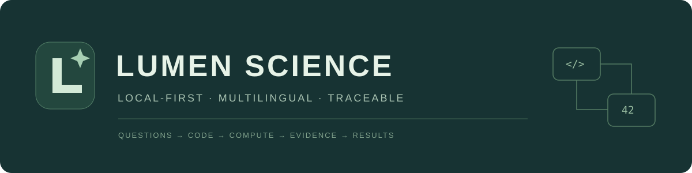

# LUMEN Science

**多语言、本地优先、可追查的 AI 科研工作台**

Connect research questions, code, compute, evidence, and results.

[快速开始](#快速开始) · [能力范围](#能力范围) · [English](README.en.md) · [贡献](CONTRIBUTING.md)

LUMEN Science 将研究项目、AI 工具调用、多语言计算、数据检查、文献元数据、结果版本与交付记录连接在一个本地界面中。你可以让 AI 协助推进任务，也可以自己编辑代码、运行流程、检查结果。

公开仓库：[zbyloveyj/LUMEN-Science](https://github.com/zbyloveyj/LUMEN-Science)。欢迎通过 Issues 提交可复现反馈，或通过 Pull Request 参与开发。

**当前版本是 0.1.0 早期预览。** 已提供可运行代码及自动验证；尚未完成多平台真实机器验收或与其他产品的系统对比，不宣称“全面超过”任何已有工作台。

## 快速开始

需要 Python 3.11 或以上。推荐在独立环境安装依赖：

~~~console
git clone https://github.com/zbyloveyj/LUMEN-Science.git
cd LUMEN-Science
python -m venv .venv
~~~

Windows：

~~~console
.venv\Scripts\python -m pip install -r requirements.txt
.venv\Scripts\python run.py
~~~

macOS / Linux：

~~~console
.venv/bin/python -m pip install -r requirements.txt
.venv/bin/python run.py
~~~

Windows 也可双击“启动科研工作台.cmd”。程序打开本机浏览器窗口，服务仅监听 127.0.0.1。默认尝试端口 8765，端口占用时自动选择空闲端口；实际地址记录在 .state/server.json。

第一次启动会创建一个含120行**合成数据**的独立示例项目，不读取其他目录中的研究数据。可以直接打开“分析流程 → 数据质量体检”体验本地分析，无需 AI 密钥。

完整使用说明见 [docs/QUICKSTART.md](docs/QUICKSTART.md)。

## 能力范围

| 功能 | 当前实现 |
|---|---|
| 项目与会话 | 新建项目、连接已有目录、独立会话、自动保存记录 |
| AI 协作 | Chat Completions / Responses 协议；读取、表格检查、多语言执行、文件创建及文献检索工具 |
| 执行控制 | 讨论模式仅提供读取工具；协作模式默认逐次核对执行；可选择本轮自动执行 |
| 多语言 Notebook | Python、R、C、C++、Java、JavaScript、TypeScript、Go、Rust、PowerShell、Bash、SQL 的执行适配 |
| 连续计算 | Python Jupyter 内核；配置 IRkernel 后可使用 R 内核；其他语言使用编译或独立进程 |
| 服务器 | 固定主机指纹的 SSH 认证、远程命令、有界输出、SFTP 目录与单文件上传/下载 |
| 数据检查 | CSV、TSV、Excel、Parquet；结构、缺失、唯一值、重复行与数值摘要 |
| 分析流程 | 数据质量、两组独立样本比较、Spearman + BH、数值变量 OLS |
| 自定义流程 | Notebook 保存为顺序流程，遇到错误停止 |
| 文献 | Crossref / PubMed 真实元数据查询、项目文献库、BibTeX 导出 |
| 结果记录 | 实际执行代码、声明输入的 SHA-256、环境信息、输出文件的确切快照 |
| 版本比较 | 结果留存、内容身份比较、CSV/TSV 表格结构及值比较 |
| 独立重跑 | 新项目目录、新解释器进程、核对并复制已声明输入 |
| 交付 | 可编辑 Markdown 分析记录、Notebook 导出、项目与运行快照 ZIP |

“提供适配”不代表自动附带所有语言环境。请在“设置与环境”中查看实际检测结果，缺失的解释器、编译器需要自行安装或配置。TypeScript 使用 Node 的类型擦除能力，不提供完整 tsc 编译语义。

Parquet 需要另装 pyarrow 或 fastparquet；旧版 .xls 需要 xlrd。可选读取依赖：

~~~console
python -m pip install -r requirements-data.txt
~~~

### C / C++ 与其他语言

自动检测 GCC / Clang，也支持 Zig 的 C/C++ 驱动。可将便携编译器安装到项目私有目录：

~~~console
python -m pip install --target .vendor ziglang==0.17.1
~~~

Java 需要 JDK，入口类为 Main；JavaScript/TypeScript 需要相应版本的 Node.js；Go、Rust、R 和 Shell 工具需要对应运行环境。可手动指定各工具完整路径。

### 连接 AI

进入“设置与环境”，填写自己的接口基础地址、模型 ID 和密钥，选择相应协议并测试连接。支持本机 HTTP 兼容服务；远程服务要求 HTTPS。

某些模型只支持特定协议。模型是否支持工具调用以及字段兼容性由服务商决定，不能仅凭聊天测试成功推断所有工具都兼容。

### 连接服务器

打开“服务器 → 添加服务器”，填写地址、端口、用户名及远程目录；使用明确指定的私钥、密码或 SSH Agent。先检测主机公钥，通过可信渠道核对指纹，再保存连接。

当前 SSH 命令面向 Linux/Unix Shell，每条命令使用独立 Shell。远程命令停止等待后，远端进程是否结束可能未知，需到服务器核查。SFTP 单次传输上限32 MiB，不覆盖同名远程文件。

## 数据与安全边界

- 项目默认在本机组织；使用在线模型时，对话及工具结果会发送到配置的服务。
- Windows 使用 DPAPI 加密保存 API 密钥和 SSH 凭证；其他系统仅保留在本次进程内存，退出后需重新填写。
- 代码以当前账户权限运行，**不提供操作系统级沙箱**。讨论模式与工作台文件接口的路径检查不限制任意代码的系统权限。
- 绑定本机接口、请求令牌、Origin 和 Host 检查用于减少其他网页对本地接口的滥用；不是多用户服务认证方案。
- 声明输入不证明程序实际读取，也不完整捕获网络、数据库、动态文件和旧内核变量。
- 独立进程运行通过不等于数值一致、科学正确或跨机复现。当前不提供完整环境锁定和全部依赖自动重建。
- 自动生成报告引用当前项目文件；运行的确切结果版本应查看交付包 runs 目录中的快照。
- 生成报告不执行科学结论审查。统计模板需要研究者核对实验设计和适用前提。

## 开发与测试

前端为原生 HTML / CSS / ES modules，无 Node 构建依赖；后端为 Python 标准库 HTTP 服务、SQLite、Jupyter Client 和可选 Paramiko。

~~~console
python -m unittest discover -s tests -v
~~~

测试会使用独立临时项目、合成数据、本机模型接口替身和 SSH/SFTP 测试服务。不会连接真实账号或业务服务器。计算内核和测试服务需要本机端口；受限执行环境可能禁止运行。

本次 Windows 验证记录与测试边界见 [docs/VERIFICATION.md](docs/VERIFICATION.md)。GitHub Actions 工作流文件已提供；在公开仓库执行前，不宣称云端 CI 已通过。

## 结构

~~~text
lumen/
  app.py          项目与业务接口
  execution.py    任务、持续内核、取消与快照
  runners.py      多语言编译和执行适配
  agent.py        模型协议、工具循环与执行核对
  remote.py       SSH 主机指纹、命令与 SFTP
  files.py        项目文件、数据预览与内容身份
  store.py        SQLite 记录
web/              本地界面
tests/            计算、接口、隔离与 SSH 验证
docs/             使用、架构、边界与推广材料
~~~

接入新的语言或数据源见 [docs/ARCHITECTURE.md](docs/ARCHITECTURE.md)。

## 路线图

下一步重点：真实跨平台验收、远程持续内核、终端交互、环境重建、更完整的依赖证据与多语言项目构建。详细状态见 [ROADMAP.md](ROADMAP.md)。

## 参与项目

欢迎提交可复现的问题、测试、语言适配和科研流程。请勿在 Issue 或日志中上传真实密钥、个人数据或受控研究资料。参见 [贡献指南](CONTRIBUTING.md) 与 [安全说明](SECURITY.md)。

项目代码采用 [MIT](LICENSE) 许可证，第三方依赖采用各自许可证。架构学习来源及依赖说明见 [ACKNOWLEDGEMENTS.md](ACKNOWLEDGEMENTS.md)。
